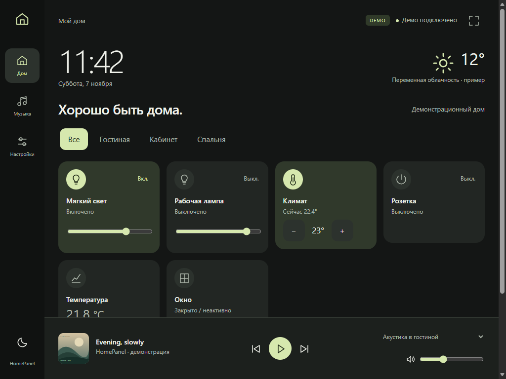

# HomePanel

> **Статус:** собран настоящий неподписанный IPA нативного UIKit-клиента
> **iPad 2 / iOS 9.3.5–9.3.6 / ARMv7**, добавлен опциональный серверный H.264 renderer.
> ARMv7 и MinimumOSVersion 9.0 проверены; установка и декодирование на iPad ещё не проверены.
>
> **Начать продолжение:** [задание для Codex на Mac](MAC-CODEX-PROMPT.md).
> [Сборка и установка IPA](ios/README.md), [renderer, Music Assistant и замеры](docs/REMOTE-DISPLAY.md).
> Music открывает настоящий MA frontend при наличии серверной конфигурации отдельного
> ограниченного пользователя. Live MA и запрет его настроек требуют интеграционной проверки.

Лёгкая локальная сенсорная панель для Home Assistant; текущий прототип интерфейса — веб-версия.
Python 3.11+, FastAPI, HTML/CSS и JavaScript ES5. Лицензия MIT.



Это исторический снимок исходного веб-прототипа, до перехода на нейтральные поверхности
и голубой акцент Home Assistant. Нативный интерфейс Music Assistant здесь не показан.

## Быстрый старт на Windows

В PowerShell из папки проекта:

```powershell
py -3 -m venv .venv
.\.venv\Scripts\python -m pip install -e ".[dev]"
.\.venv\Scripts\python -m uvicorn homepanel.app:app --host 127.0.0.1 --port 8090
```

Откройте http://127.0.0.1:8090. По умолчанию включён **DEMO**: вымышленные устройства,
погода, ПК, плееры и сценарии. Звука и сетевых обращений к HA в этом режиме нет.
Действия меняют только память процесса; перезапуск сбрасывает демо.

Альтернатива с uv: `uv sync --extra dev`, затем `uv run uvicorn homepanel.app:app --port 8090`.

## Подключение Home Assistant

1. Скопируйте `configuration/config.example.yaml` в `configuration/config.yaml`.
2. Скопируйте `example.env` в `.env`, задайте `HOMEPANEL_DEMO=false`, `HA_URL`,
   `HA_TOKEN` и уникальный `PANEL_PASSWORD` длиной от 12 символов.
3. В YAML укажите разрешённые entity_id, имена и комнаты. Для сценариев укажите
   существующие `script.*` или `scene.*`. Пустые сценарии отключены.
4. Перезапустите сервер. Для LAN явно добавьте IP/имя панели в `allowed_hosts`
   и запустите с `--host 0.0.0.0`. Откройте порт в firewall только для домашней сети.

Токен HA создаётся в профиле HA (Long-Lived Access Tokens). Используйте отдельного
пользователя с минимальными правами. HA URL и токен остаются на сервере. Не добавляйте
`.env` и личную конфигурацию в Git. YAML меняется на сервере, перезапуск применяет его.
Настройки в браузере показывают список разрешённых сущностей и меняют тему, ночную
яркость и выбранный плеер. Это не редактор серверных разрешений.

## Возможности MVP

- Часы/дата, погода (`weather` либо sensor с role: weather), комнаты и карточки устройств.
- Light: переключение и яркость; switch: переключение; climate: целевая температура.
- Sensor/binary_sensor: показ значений; button/script/scene: активация.
- ПК: явно выбранные sensor/binary_sensor с role: computer. Никаких фиктивных
  CPU/RAM/онлайн-статусов в реальном режиме.
- Gaming, Movie, Sleep, Study вызывают только серверные привязки.
- Media players: выбор, название/исполнитель/альбом, безопасная обложка,
  play/pause, previous/next, громкость и позиция по возможностям сущности.
- Музыкальный экран, полноэкранный режим с fallback для Safari, тёмная/светлая темы,
  ночной диммер, touch/keyboard управление, loading/offline/unavailable/error.
- HA REST polling: общий краткий кэш, таймауты, задержка повторов до 60 секунд.
  Скрытые страницы опрашивают реже. WebSocket и SQLite для MVP не нужны.

## Music Assistant

Установите официальную интеграцию Music Assistant **в самом HA**, затем выберите
её `media_player.*` в YAML. Доступные плееры в HomePanel ограничены этим списком.
Функции включаются по `supported_features`, данные берутся из стандартных атрибутов HA.
Позиция интерполируется только при наличии duration, position и timestamp; перемотка
доступна только при поддержке seek. Если HA не сообщает метаданные, показан placeholder.

Обложки проксируются сервером только по стандартному относительному пути HA
`/api/media_player_proxy/<entity_id>`. Внешние и нестандартные URL не загружаются;
это намеренное ограничение SSRF и утечки токенов. Ссылки с HA-токенами не попадают в HTML.
Демонстрационная обложка нарисована локально в SVG.

Поиск музыки и просмотр/редактирование очереди **не реализованы в MVP**.
Официальные `music_assistant.search` и `music_assistant.get_queue` подходят для
следующего этапа после проверки конкретной версии MA. Прямого MA API и DRM-обходов нет.
HomePanel управляет уже настроенным плеером; браузер не декодирует музыку.

## Безопасность

Реальный режим не стартует без пароля и HA-токена. Сессии — случайные серверные
идентификаторы в HttpOnly cookie, 12 часов, сбрасываются при перезапуске. CSRF-токен
проверяется на каждом изменяющем запросе; foreign Origin отклоняется, включая login.
Список сервисов фиксирован, параметры и диапазоны проверяются сервером. После
сетевой ошибки управляющий POST не повторяется автоматически. Login ограничен
8 неудачными попытками за 5 минут на IP. API и обложки требуют сессии.

Анонимный demo получает отдельную CSRF-сессию автоматически. Для закрытого демо
тоже задайте PANEL_PASSWORD. До 128 одновременных сессий. Нет CORS и публичной
регистрации. API-ответы не кэшируются. Доверенные Host задаются явно против DNS rebinding.
Не публикуйте порт в интернете. Для удалённого доступа нужен VPN или доверенный HTTPS
reverse proxy; при HTTPS задайте `HOMEPANEL_SECURE_COOKIE=true`. Не доверяйте forwarded
headers от произвольных прокси. Локальный HTTP не шифрует пароль: используйте его
только в доверенной LAN с учётом ограничений TLS старого iPad.

## Safari iOS 9 / iPad 2

Основной интерфейс использует ES5, XMLHttpRequest, обычные CSS-значения, floats и
inline-block. CSS-токены имеют обычные fallback-значения. Нет обязательных Grid, fetch, Promise, modules, optional chaining,
backdrop-filter, обязательных внешних шрифтов или CDN.

Реальный iPad 2 в этой среде **не тестировался**. Проверка ES5 и современного Chromium
не доказывает совместимость iOS 9. Нужны ручные проверки: Safari 9.3.5/9.3.6,
1024×768, touch sliders/select, сессия после сна, потеря Wi-Fi, локальные SVG.
У старого Safari нет Screen Wake Lock и надёжного Fullscreen API: добавьте страницу
на домашний экран, включите Guided Access и отключите автоблокировку в iOS.
При выходе из сна страница заново запрашивает данные. Приложение не удерживает iPad
от сна программно. Затемнение интерфейса не меняет аппаратную яркость экрана.
На старой iOS импорт сертификатов и современные TLS-цепочки могут не работать.

## Docker

```sh
docker compose up --build -d
```

Compose по умолчанию публикует **127.0.0.1:8090**. Файл `.env` должен существовать
(можно скопировать example.env без live-секретов). Для LAN измените bind осознанно.
Контейнер работает без root. Docker build здесь отдельно от Python-тестов.

## Home Assistant OS app

В `ha-app/homepanel` подготовлены metadata, Dockerfile, запуск и инструкция.
Скрипт `scripts/prepare-ha-app.ps1` копирует актуальный source в контекст сборки.
Скопируйте подготовленную папку в `/addons/homepanel` на HAOS через доступный вам
способ и выполните Reload в локальном app store. Автоустановки и изменений HA нет.
Подробности и ограничения: [ha-app/homepanel/README.md](ha-app/homepanel/README.md).

## Разработка

```sh
uv sync --extra dev --extra renderer
uv run pytest
uv run ruff check homepanel tests scripts/display-smoke.py
uv run ruff format --check homepanel tests scripts/display-smoke.py
npm ci --ignore-scripts
npm run check:es5
```

Тесты используют только Demo и httpx MockTransport; реальных команд HA нет.
Node.js нужен только для проверки ES5 (Acorn), для запуска панели он не нужен.
Опциональная браузерная проверка `scripts/browser-qa.mjs` использует OmOWright:
задайте HOMEPANEL_OMOWRIGHT_LOADER (file URL его loader модуля) и
HOMEPANEL_BROWSER_PATH (путь к Chromium/Edge), предварительно запустите demo на 8090.
Схема: `homepanel/` — backend; `homepanel/integrations/` — HA и demo;
`homepanel/frontend/` — статический UI; `configuration/` — YAML;
`tests/` — серверные проверки; `docs/` — протокол проверки.

Официальные источники:
[HA REST API](https://developers.home-assistant.io/docs/api/rest/),
[media_player](https://developers.home-assistant.io/docs/core/entity/media-player/),
[Music Assistant](https://www.home-assistant.io/integrations/music_assistant/),
[HA app configuration](https://developers.home-assistant.io/docs/add-ons/configuration/).
